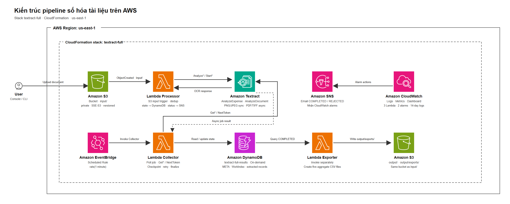

# Pipeline số hóa hóa đơn và biểu mẫu với Amazon Textract

Dự án môn Điện toán đám mây xây dựng pipeline serverless trên AWS để tiếp nhận tài liệu scan, trích xuất dữ liệu và lưu kết quả có cấu trúc. Môi trường triển khai là AWS Academy Learner Lab; bộ dữ liệu đánh giá gồm tài liệu tổng hợp bằng tiếng Anh, không đại diện cho mọi hóa đơn hoặc biểu mẫu thực tế.

## Chức năng

- Nhận tài liệu từ Amazon S3; trigger chỉ theo dõi prefix **input/**.
- Dùng Amazon Textract AnalyzeExpense cho hóa đơn và AnalyzeDocument với FORMS, TABLES cho biểu mẫu.
- Lambda Processor xử lý ảnh một trang đồng bộ; PDF/TIFF nhiều trang dùng API bất đồng bộ, được Lambda Collector tiếp tục polling theo lịch EventBridge.
- Lưu trạng thái và dữ liệu có cấu trúc trong DynamoDB; lưu JSON và CSV trong cùng bucket S3.
- Lambda Exporter được gọi riêng để tạo năm CSV tổng hợp trong **output/exports/**.
- Gửi thông báo trạng thái qua SNS; theo dõi log, metric và cảnh báo bằng CloudWatch.

S3 chỉ phát sự kiện từ **input/**; thao tác ghi vào **output/** không được thiết kế để gọi Processor. Phép thử âm xác nhận không có invocation vẫn cần được kiểm tra riêng bằng log/metric trong cửa sổ thời gian phù hợp; smoke script không tự xác nhận phép thử này.

## Kiến trúc

- Sơ đồ PNG để chèn vào báo cáo: [docs/architecture-target.png](docs/architecture-target.png)
- Luồng xử lý, IAM, VPC và giới hạn: [docs/architecture.md](docs/architecture.md)
- Icon dịch vụ lấy từ bộ AWS Architecture Icons chính thức; thông tin nguồn nằm trong [docs/assets/aws-architecture-icons-2026q3/README.md](docs/assets/aws-architecture-icons-2026q3/README.md).

Sơ đồ chỉ mô tả các tài nguyên pipeline trong **infra/template.yaml**. VPC được dựng ở tuần 1 như hạ tầng nền riêng, không thuộc luồng xử lý tài liệu; Lambda không gắn vào VPC này và template CloudFormation không tạo VPC. Stack dùng LabRole có sẵn, triển khai trong một Region; sơ đồ không thể hiện failover đa Region.

## Lựa chọn dịch vụ và ràng buộc

| Dịch vụ | Vai trò và lý do chọn | Bảo mật, khả dụng và chi phí |
| --- | --- | --- |
| Amazon S3 | Điểm nhận tài liệu và nơi lưu kết quả; S3 event tách thao tác upload khỏi xử lý. | Bucket riêng tư, Block Public Access, SSE-S3, versioning, HTTPS-only; trigger lọc input/. Dữ liệu/version lưu lâu có thể tiếp tục phát sinh phí. |
| AWS Lambda | Tách Processor, Collector và Exporter theo nhiệm vụ; không cần máy chủ thường trực. | Dùng LabRole có sẵn và không gắn VPC. Khả năng mở rộng của dịch vụ không thay thế kiểm thử tải của dự án. |
| Amazon Textract | Trích xuất hóa đơn, key-value và bảng; API bất đồng bộ phù hợp tài liệu nhiều trang. | Chi phí phụ thuộc loại API và số trang xử lý; kết quả được đánh giá riêng với ground truth. |
| Amazon DynamoDB | Giữ trạng thái, lease, JobId và bản ghi chi tiết; WorkIndex giúp Collector tìm job đến hạn. | PAY_PER_REQUEST phù hợp tải thử nhỏ, biến động; dung lượng dữ liệu và số lần đọc/ghi vẫn ảnh hưởng chi phí. |
| Amazon EventBridge | Gọi Collector theo lịch mỗi phút để tiếp tục job bất đồng bộ. | Tạo lượt gọi định kỳ kể cả khi không có job; có thể tắt rule khi không cần chạy pipeline. |
| Amazon SNS | Gửi email trạng thái và nhận thông báo từ CloudWatch alarms. | Chỉ dùng topic của dự án và subscription đã xác nhận. |
| Amazon CloudWatch | Lưu log, theo dõi metric, dashboard và hai alarms. | Log group được đặt retention 14 ngày; thời gian lưu log ảnh hưởng dung lượng và chi phí. |

Hệ thống được kiểm thử trong us-east-1, không có cấu hình hoặc phép thử khôi phục liên vùng. Pipeline không dùng VPC tuần 1; Lambda không gắn VPC nên không cần NAT Gateway cho luồng serverless hiện tại.

## Mã nguồn và tài liệu

~~~text
infra/template.yaml               CloudFormation cho stack pipeline
src/textract_pipeline/             Mã Lambda và logic xử lý
tools/deploy.ps1                   Triển khai một deployment run đã kiểm tra
tools/cleanup.ps1                  Backup rồi cleanup stack
tools/smoke_aws.py                 Smoke test AWS
tools/evaluate.py                  Đối chiếu CSV với ground truth
data/samples/baseline-v1/          30 ảnh mẫu và ground truth
docs/architecture.md               Thiết kế và giới hạn kiến trúc
docs/guides/deployment.md          Hướng dẫn triển khai chi tiết
docs/guides/testing.md             Hướng dẫn smoke, accuracy và kiểm tra thủ công
docs/guides/operations.md          Vận hành, giám sát, chi phí, cleanup
docs/week1/ ... docs/week4/        Tài liệu và bằng chứng theo tuần
WORKLOG.md                         Worklog và đóng góp theo tuần
~~~

## Chuẩn bị môi trường local

Cần Python 3.12 trở lên và AWS CLI v2 cho các bước cần gọi AWS.

~~~powershell
py -3.12 -m venv .venv
.venv\Scripts\Activate.ps1
python -m pip install --upgrade pip
pip install -e ".[dev]"
~~~

Có thể chạy bộ unit test offline bằng **python -m pytest -ra**. Hướng dẫn kiểm thử AWS và những phần cần xác nhận thủ công nằm trong [docs/guides/testing.md](docs/guides/testing.md).

Không lưu AWS access key, secret key hoặc session token vào Git, source code, ảnh chụp hay báo cáo. Chỉ dùng temporary credentials do Learner Lab cấp. Trước khi gọi AWS, xác nhận account và Region:

~~~powershell
aws sts get-caller-identity --region us-east-1 --no-cli-pager
aws configure get region
~~~

## Triển khai CloudFormation

Chỉ deploy sau khi Start Learner Lab, nạp temporary credentials cho AWS CLI và kiểm tra đúng account/Region. Script mặc định yêu cầu account **535709085695**; không bỏ qua guard này nếu chưa xác nhận mình đang dùng đúng lab. Tài khoản khác cần được chọn rõ ràng bằng tham số **-ExpectedAccount**.

Tạo package, kiểm tra package và source snapshot, sau đó deploy đúng run đã kiểm tra:

~~~powershell
$deploymentRun = "artifacts/runs/$(Get-Date -Format yyyyMMdd-HHmmss)-aws-deployment-$([guid]::NewGuid().ToString('N').Substring(0,8))"

.venv/Scripts/python.exe tools/package.py --run-dir $deploymentRun --kind aws_deployment
.venv/Scripts/python.exe tools/verify_package.py --run-dir $deploymentRun
.venv/Scripts/python.exe tools/bundle_source.py --run-dir $deploymentRun

./tools/deploy.ps1 -RunDir $deploymentRun -ArtifactBucket textract-pipeline-535709085695 -Region us-east-1 -Prefix textract-full -Owner 24110372-24110381 -Email 'EMAIL_NHAN_THONG_BAO'
~~~

Thay **EMAIL_NHAN_THONG_BAO** bằng địa chỉ email của người nhận SNS. Sau deploy, xác nhận stack CREATE_COMPLETE hoặc UPDATE_COMPLETE, subscription SNS Confirmed, trigger S3 lọc đúng input/, EventBridge rule có trạng thái dự kiến và CloudWatch resources tồn tại. Chi tiết từng bước và lựa chọn nâng cấp tài nguyên tuần 1 xem [docs/guides/deployment.md](docs/guides/deployment.md).

## Chạy thử trên AWS

Sau khi deploy thành công, có thể chạy smoke nhỏ với hai PNG và một PDF nhiều trang:

~~~powershell
.venv/Scripts/python.exe tools/smoke_aws.py --stack textract-full --region us-east-1 --learner-lab-active --deployment-run $deploymentRun
~~~

Đường dẫn run kết quả được in ra terminal. Đối chiếu smoke.json, trạng thái DynamoDB, CSV, SNS email và CloudWatch. Smoke script kiểm tra cấu hình prefix nhưng không tự khẳng định upload vào output/ không tạo invocation; kiểm tra âm này được hướng dẫn riêng trong [docs/guides/testing.md](docs/guides/testing.md).

Đánh giá accuracy trên ít nhất 30 mẫu cần dùng run riêng và ground truth tương ứng. Làm theo các bước trong [docs/guides/testing.md](docs/guides/testing.md); không coi việc 30 tài liệu hoàn tất là chỉ số accuracy.

## Cleanup và kiểm tra trạng thái cuối

Chỉ cleanup sau khi lưu báo cáo, video, CSV và bằng chứng cần bàn giao. Lệnh dưới đây kiểm tra project tag, yêu cầu xác nhận đúng tên bucket, tắt lịch và trigger, chờ invocation đang chạy rồi backup object versions cùng DynamoDB items trước khi xóa stack:

~~~powershell
./tools/cleanup.ps1 -Stack textract-full -Region us-east-1
~~~

**Mặc định script giữ lại bucket S3 dữ liệu và DynamoDB table** do DeletionPolicy: Retain; bucket chứa ZIP triển khai (artifact bucket) cũng không bị xóa. Các resource còn lại vẫn có thể phát sinh phí lưu trữ. Vì vậy, xóa stack không đồng nghĩa đã xóa mọi tài nguyên. Kiểm tra riêng CloudFormation, Lambda/EventBridge, S3, DynamoDB và artifact bucket sau cleanup.

Chỉ dùng **-PurgeData** nếu đã lưu và kiểm tra backup, được phép xóa dữ liệu, và chọn chế độ này khi stack vẫn còn tồn tại:

~~~powershell
./tools/cleanup.ps1 -Stack textract-full -Region us-east-1 -PurgeData
~~~

**-PurgeData** xóa mọi version/delete marker trong bucket dữ liệu rồi xóa bucket và table; không thể giữ lại VersionId cũ khi khôi phục. Script không xóa artifact bucket hoặc LabRole. Hướng dẫn cleanup thủ công cho tài nguyên tuần 1 nằm trong [docs/guides/operations.md](docs/guides/operations.md).

End Lab chỉ kết thúc phiên truy cập; không thay thế việc cleanup và kiểm tra tài nguyên còn tồn tại.

## Tài liệu

- [Thiết kế kiến trúc](docs/architecture.md)
- [Worklog nhóm](WORKLOG.md)
- [Hướng dẫn triển khai](docs/guides/deployment.md)
- [Hướng dẫn kiểm thử](docs/guides/testing.md)
- [Hướng dẫn vận hành và cleanup](docs/guides/operations.md)
- [Báo cáo và minh chứng tuần 3](docs/week3/README.md)
