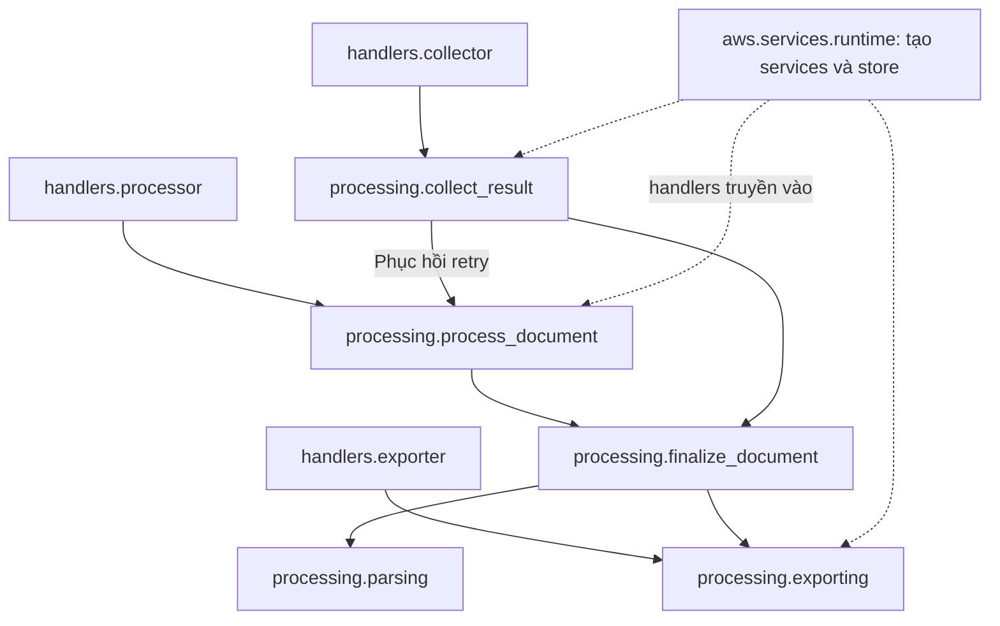
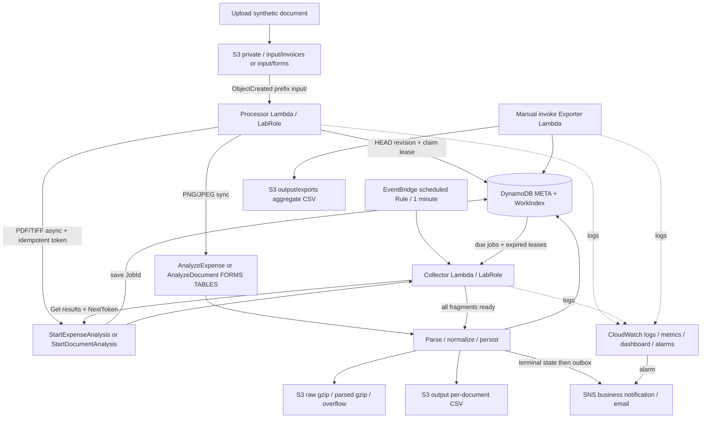

# Kiến trúc hệ thống

## 1. Mục tiêu và phạm vi

Trích xuất thông tin hóa đơn/biểu mẫu scan, lưu cấu trúc để truy vấn và xuất CSV. Bản này là dự án Learner Lab nhỏ, không phải dịch vụ đa khách hàng production. Không có UI/API công khai; người dùng upload và tải CSV qua AWS Console/CLI. Mọi tài liệu kiểm thử là synthetic.

Tài nguyên trong cùng `us-east-1` hoặc `us-west-2`; Lambda dùng LabRole có sẵn. Không sửa trust policy/quyền của LabRole và không tạo IAM mới. Nếu LabRole hoặc session bị explicit deny, dừng thao tác đó, lưu bằng chứng và hỏi giảng viên.

## 2. Kiến trúc code và sơ đồ AWS

Cây thư mục hiện hành và quy tắc đặt file: [structure.md](structure.md). Ba điểm vào Lambda nằm trong `handlers/`; logic nằm trong `processing/`; API AWS và DynamoDB nằm trong `aws/`. Công cụ local nằm trong `tools/`, ngoài package deploy.

`finalize_document` là đường dùng chung để lưu kết quả, xuất CSV từng tài liệu và quản lý thông báo/lỗi. `processing` không khởi tạo client AWS hoặc import handler. Các handler dùng lại runtime để truyền services/store vào luồng xử lý.

Sơ đồ kiến trúc pipeline: [PNG để chèn báo cáo](architecture-target.png). Sơ đồ dùng icon AWS chính thức; các icon đã chọn và nguồn tải được ghi trong [tài liệu icon](assets/aws-architecture-icons-2026q3/README.md). Khung AWS Region mô tả các tài nguyên pipeline trong infra/template.yaml. VPC nền tảng tuần 1 không được vẽ vì không thuộc luồng xử lý của pipeline; template không tạo VPC và Lambda không gắn vào VPC đó.

## 3. VPC nền tảng và vị trí của Lambda

Trong tuần 1, nhóm tạo VPC `vpc-0111c067a9d554f2b` ở account `535709085695`, Region `us-east-1`, CIDR `10.20.0.0/16`. VPC có subnet `10.20.1.0/24` ở `us-east-1a` và `10.20.2.0/24` ở `us-east-1b`. Hai subnet dùng route table chính `rtb-0eef4575988f1cee6`; bảng định tuyến chỉ có route nội bộ `10.20.0.0/16 → local`. VPC và subnet được gắn tag `Project` và `Owner`.

VPC là tài nguyên nền tảng của lab, nhưng các Lambda không gắn vào VPC này. S3, Textract, DynamoDB và SNS là dịch vụ AWS được gọi bằng API theo Region; pipeline không cần truy cập máy chủ hoặc cơ sở dữ liệu riêng trong subnet. Vì vậy không tạo NAT Gateway hoặc route Internet cho VPC. Cấu hình này đáp ứng phần nền tảng tuần 1 mà không phát sinh đường mạng và chi phí không cần cho luồng serverless.

## 4. Luồng synchronous

1. Upload PNG/JPEG ≤10 MB vào đúng prefix. S3 event cung cấp key URL-encoded, ETag và VersionId nếu bucket versioned.
2. Processor decode key, bỏ qua folder marker và prefix không hỗ trợ; HEAD đúng version để lấy kích thước/metadata.
3. ID = SHA256 của `(bucket, key, version_id hoặc ETag)`. Bucket versioning được bật trong IaC, vì vậy overwrite là revision khác, không ghi đè kết quả cũ.
4. Conditional Put/Update META để giành lease 240 giây. Nếu tài liệu hoàn tất/đang có lease thì skip duplicate.
5. Invoice gọi AnalyzeExpense; form gọi AnalyzeDocument với FORMS, TABLES. Lưu raw JSON gzip vào S3 và checkpoint DDB.
6. Parser theo relationships Textract: KEY→VALUE→WORD/SELECTION_ELEMENT; TABLE→CELL/MERGED_CELL; expense SummaryFields/LineItemGroups. Bảo toàn confidence/page/spans/duplicate field types.
7. Lưu parsed JSON gzip, các record FIELD/LINE_ITEM/TABLE_CELL. Item JSON >300 KB chuyển sang S3 và DDB chỉ giữ pointer để có khoảng an toàn dưới giới hạn item 400 KB.
8. Xuất 5 CSV từng tài liệu; đánh dấu COMPLETED; sau đó gửi SNS. Nếu SNS lỗi thì kết quả vẫn COMPLETED, notification=PENDING và Collector retry.

## 5. Luồng asynchronous

1. PDF/TIFF mặc định async. Giới hạn dự án chủ động thấp hơn giới hạn dịch vụ: 50 MB/file, 100 trang, tổng raw JSON không quá 32 MB để vừa Lambda 1 GB.
2. Processor gọi StartDocumentAnalysis/StartExpenseAnalysis với ClientRequestToken=document_id. Không truyền NotificationChannel; lưu JobId, trạng thái SUBMITTED, due_at rồi kết thúc ngay, không sleep chờ trong Lambda.
3. EventBridge **scheduled Rule** chạy mỗi phút. Lambda resource policy cho phép events.amazonaws.com invoke Collector; không dùng EventBridge Scheduler cần execution role riêng.
4. Collector Query WorkIndex lấy tối đa 10 jobs đến hạn, giành lease từng job. IN_PROGRESS → defer; FAILED → lưu FAILED và thông báo; SUCCEEDED/PARTIAL_SUCCESS → tải fragment.
5. Mỗi fragment lưu `chunks/000000.json.gz`, rồi checkpoint NextToken/count/byte-size trong META. Nếu Lambda gần hết thời gian, release lease và tiếp tục ở tick sau. Nếu crash giữa save S3 và checkpoint, ghi lại cùng chunk an toàn.
6. Khi hết NextToken, ghép blocks theo Id và expense fragments; parse qua đường lưu chung với sync. PARTIAL_SUCCESS được lưu PARTIAL, không giả làm COMPLETED. CSV tổng hợp mặc định không lấy children PARTIAL.
7. Job quá 6 ngày bị dừng để tránh sát hạn lưu kết quả 7 ngày của Textract. Collector cũng phục hồi PROCESSING/RETRYABLE có lease hết hạn, kể cả crash trước khi kịp lưu JobId; Start token giúp tránh tạo job async trùng trong thời hạn token.

NotificationChannel là tùy chọn trong [StartDocumentAnalysis API](https://docs.aws.amazon.com/textract/latest/APIReference/API_StartDocumentAnalysis.html). Cách polling tránh yêu cầu thêm Textract service role/trust/iam:PassRole cho completion channel. Không có nghĩa LabRole mặc nhiên có mọi quyền Textract/EventBridge: vẫn phải kiểm tra trên lab.

## 6. Retry, idempotency, giới hạn

- Lease dài hơn timeout Lambda 180 giây; không tự tăng Lambda timeout mà bỏ qua LEASE_SECONDS.
- Transient SDK errors: tối đa 5 lần lỗi xử lý, exponential backoff tối đa 15 phút. Retry sync sau khi raw được checkpoint sẽ dùng lại raw, không gọi OCR lần nữa.
- Crash giữa Analyze và checkpoint vẫn có thể tính phí OCR lại. S3/Lambda/SNS đều có thể giao lặp; thiết kế là at-least-once với dedup/conditional state, không exactly-once.
- SNS retry tối đa 8 lần; notification FAILED phải được kiểm tra riêng với status extraction.
- Export aggregate Scan phù hợp vài chục tài liệu, không tối ưu hàng triệu tài liệu. WorkIndex dùng 1 work partition, phù hợp lab; scale lớn cần sharding/queue/streaming export.
- DDB write nhiều children không phải transaction. Exporter chỉ lấy children của META COMPLETED; các lần phục hồi dùng cùng raw và deterministic SKs. Raw/parsed không tự hết hạn trước khi job phục hồi.
- PNG/JPEG 1 trang, PDF/TIFF sync chỉ 1 trang. File không hỗ trợ bị REJECTED; PDF mã hóa/password và nội dung lỗi có thể FAILED từ Textract.

## 7. IAM và tagging

| Principal | Quyền/nguồn cần kiểm tra | Ghi chú |
|---|---|---|
| Session sinh viên | CloudFormation, tạo/cập nhật/tag S3/DDB/SNS/Lambda/EventBridge/Logs/Alarm; iam:PassRole cho LabRole | Không tạo role mới; explicit deny không thể giải quyết bằng attach policy tùy ý |
| LabRole | s3:GetObject/GetObjectVersion/PutObject trên bucket; dynamodb:GetItem/PutItem/UpdateItem/Query/Scan/BatchWriteItem và index; textract:AnalyzeDocument/AnalyzeExpense/StartDocumentAnalysis/StartExpenseAnalysis/GetDocumentAnalysis/GetExpenseAnalysis; sns:Publish; logs:CreateLogStream/PutLogEvents | Đây là checklist, không phải yêu cầu tạo IAM policy mới |
| S3 service | Lambda resource-based permission, SourceArn đúng bucket, SourceAccount đúng account | Khác execution role |
| EventBridge service | Lambda resource-based permission, SourceArn đúng rule | Không gắn thêm role cho rule Lambda target |

Tag Project=TextractDocumentDigitization và Owner=24110372-24110381 áp dụng resource có hỗ trợ tags: bucket, table, topic, 3 functions, 3 log groups, scheduled rule, 2 alarms, stack. Dashboard, Lambda Permission/EventInvokeConfig, MetricFilter, SNS Subscription/TopicPolicy, BucketPolicy không có trường Tags trong resource schema tương ứng; ghi nhận ngoại lệ thay vì tạo cấu hình không hợp lệ. LabRole là tài nguyên có sẵn của lab, không sửa tags/quyền khi không được phép.

Giới hạn/ngôn ngữ tham chiếu: [Textract document limits](https://docs.aws.amazon.com/textract/latest/dg/limits-document.html). Dùng mẫu tiếng Anh; nếu cần hóa đơn tiếng Việt, đây là một giới hạn phải đánh giá/đổi dịch vụ, không cam kết accuracy tiếng Việt.
