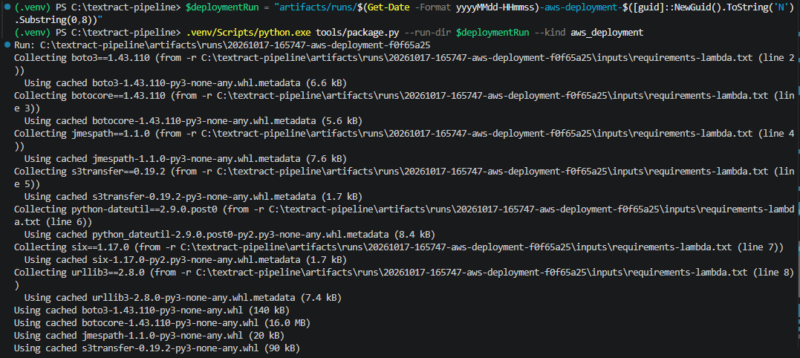
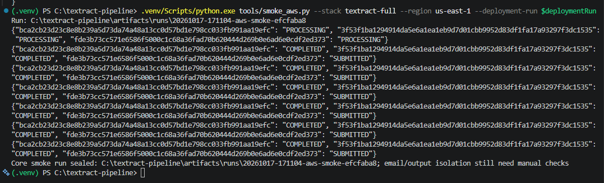
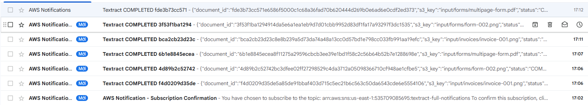
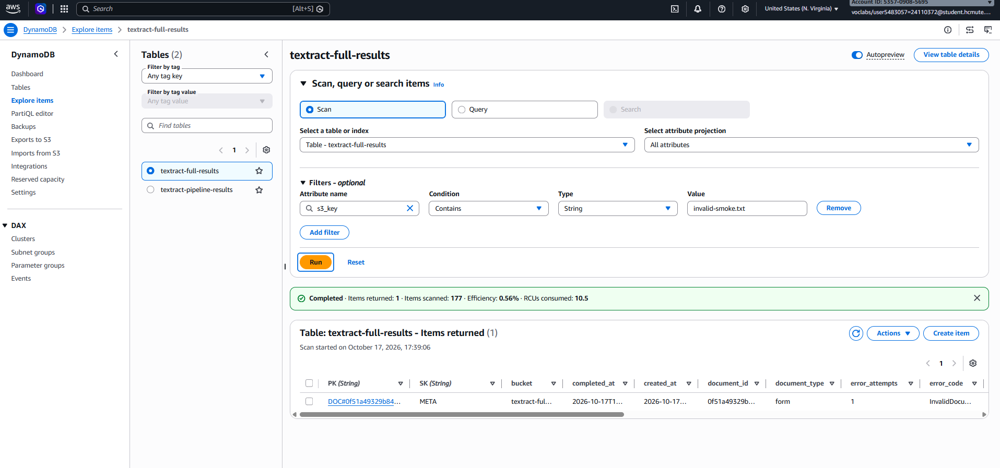
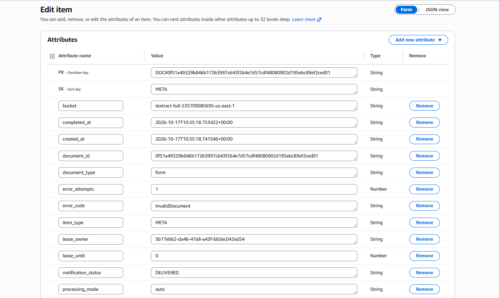

# Báo cáo công việc tuần 2 — Triển khai pipeline Amazon Textract

## 1. Mục tiêu

Trong tuần 2, nhóm chuyển phần xử lý tài liệu từ mã nguồn sang môi trường AWS Learner Lab. Công việc gồm đóng gói các hàm Lambda, kiểm tra gói triển khai, tạo stack bằng CloudFormation và chạy thử luồng hóa đơn, biểu mẫu, PDF nhiều trang. Nhóm cũng kiểm tra việc chống xử lý trùng, xử lý đầu vào không hợp lệ và xuất dữ liệu ra CSV.

Phạm vi báo cáo này dựa trên manifest của lần đóng gói, lần triển khai, kết quả smoke test và ảnh chụp AWS/Gmail lưu cùng thư mục. Các lượt triển khai lỗi trước đó không được tính là kết quả hoàn thành.

## 2. Môi trường triển khai

| Thành phần | Giá trị |
| --- | --- |
| Môi trường | AWS Academy Learner Lab |
| AWS account | `535709085695` |
| Region | `us-east-1` (US East, N. Virginia) |
| CloudFormation stack | `textract-full` |
| Artifact bucket | `textract-pipeline-535709085695` |
| IAM execution role | `LabRole` có sẵn trong Learner Lab |
| Kết quả triển khai | `CREATE_COMPLETE` |

## 3. Đóng gói và kiểm tra Lambda

Nhóm dùng `tools/package.py` để tạo gói triển khai gồm mã nguồn Lambda và các thư viện runtime. Gói được dùng cho ba hàm Processor, Collector và Exporter. Lệnh `tools/verify_package.py` kiểm tra tính toàn vẹn ZIP, khả năng import handler và mô hình Textract trong AWS SDK. Sau đó `tools/bundle_source.py` tạo thêm ZIP mã nguồn dự án để lưu cùng lượt chạy.

| Gói | Kích thước | SHA-256 |
| --- | ---: | --- |
| `textract-pipeline.zip` | 16.661.135 byte | `f98475f3d1dca36e2f56d31587030bab15b5683e2f91f90d83d49a518a972b13` |
| `textract-project-source.zip` | 9.671.989 byte | `3626daee00009ccbcc13cea041cc1aa71449705e741870c3bed8957fb24ddec4` |

Các bước build, kiểm tra ZIP/handler/SDK và tạo source bundle đều có trạng thái `PASS` trong deployment manifest.

Hình 1. Chạy script đóng gói Lambda trong môi trường Python của dự án.

## 4. Triển khai hạ tầng lên AWS

Nhóm triển khai template `infra/template.yaml` bằng script `tools/deploy.ps1`. CloudFormation tạo stack `textract-full` trên account `535709085695`, Region `us-east-1`; manifest ghi nhận trạng thái `CREATE_COMPLETE`.

Các tài nguyên chính được tạo trong stack:

| Loại | Tên tài nguyên |
| --- | --- |
| S3 bucket xử lý | `textract-full-535709085695-us-east-1` |
| DynamoDB table | `textract-full-results` |
| Lambda tiếp nhận và xử lý tài liệu | `textract-full-processor` |
| Lambda thu thập kết quả bất đồng bộ | `textract-full-collector` |
| Lambda xuất dữ liệu | `textract-full-exporter` |
| Lambda poller | `textract-full-poller` |
| SNS topic | `textract-full-notifications` |

Sự kiện S3 `ObjectCreated` được giới hạn ở prefix `input/`. Cấu hình này giữ các tệp xuất trong `output/` ngoài phạm vi trigger của Processor. Lượt chạy smoke test ghi nhận được cấu hình filter này; kiểm tra riêng bằng cách tải một tệp vào `output/` để xác nhận không phát sinh invocation mới chưa được đánh dấu là đã chạy thủ công trong manifest.

## 5. Kiểm thử luồng xử lý tài liệu

Nhóm dùng `tools/smoke_aws.py` để tải bộ tài liệu kiểm thử lên S3, theo dõi trạng thái trong DynamoDB và gọi Exporter. Ba đầu vào hợp lệ đều chuyển sang trạng thái `COMPLETED`:

| Tài liệu | S3 key | Kết quả |
| --- | --- | --- |
| Hóa đơn ảnh | `input/invoices/invoice-001.png` | `COMPLETED` |
| Biểu mẫu ảnh | `input/forms/form-002.png` | `COMPLETED` |
| Biểu mẫu PDF nhiều trang | `input/forms/multipage-form.pdf` | `COMPLETED` |

PDF được tiếp nhận qua luồng bất đồng bộ; Poller gọi Collector để lấy kết quả Textract và cập nhật trạng thái tài liệu. Ảnh chụp hộp thư ghi nhận các thông báo `COMPLETED` gửi qua SNS cho những tài liệu trong lượt kiểm thử.

Hình 2. Lệnh smoke test theo dõi trạng thái của các tài liệu trên stack đã triển khai.

Hình 3. Hộp thư nhận thông báo xử lý hoàn tất cho hóa đơn, biểu mẫu và PDF.

### 5.1. Kiểm tra sự kiện trùng

Nhóm gửi lại sự kiện của hóa đơn đã được xử lý. Kết quả ghi trong smoke output là `DUPLICATE_OR_IN_PROGRESS`, cho thấy hệ thống nhận diện tài liệu đang xử lý hoặc đã có bản ghi thay vì khởi tạo một lượt xử lý mới.

### 5.2. Kiểm tra đầu vào không hợp lệ

Nhóm đưa `input/forms/invalid-smoke.txt` vào pipeline. Bản ghi tương ứng trong DynamoDB có mã lỗi `InvalidDocument`; ảnh chụp item cho thấy `notification_status` là `DELIVERED`. Hộp thư cũng ghi nhận email SNS với trạng thái `REJECTED`.

Hình 4. Tìm bản ghi ứng với `invalid-smoke.txt` trong bảng `textract-full-results`.

Hình 5. Bản ghi lưu mã lỗi `InvalidDocument` và trạng thái thông báo `DELIVERED`.

## 6. Xuất dữ liệu CSV

Exporter tạo năm tệp trong `output/exports/`. Số dòng dưới đây là số liệu tổng hợp của bảng tại thời điểm chạy, có thể bao gồm dữ liệu được tạo trước lượt smoke test này; đây không phải số lượng chỉ riêng ba tài liệu vừa kiểm thử.

| Tệp | Số dòng dữ liệu |
| --- | ---: |
| [documents.csv](evidence/exports/documents.csv) | 6 |
| [fields.csv](evidence/exports/fields.csv) | 46 |
| [line_items.csv](evidence/exports/line_items.csv) | 4 |
| [table_cells.csv](evidence/exports/table_cells.csv) | 120 |
| [table_rows.csv](evidence/exports/table_rows.csv) | 42 |

## 7. Kết quả tuần 2

- Đóng gói được mã Lambda và xác nhận các kiểm tra ZIP, handler import, Textract SDK model đều đạt.
- Tạo được CloudFormation stack `textract-full` trên đúng Learner Lab account `535709085695`; trạng thái ghi nhận là `CREATE_COMPLETE`.
- Xử lý thành công ba loại tài liệu mẫu gồm hóa đơn ảnh, biểu mẫu ảnh và PDF nhiều trang.
- Kiểm tra được phản hồi chống xử lý trùng `DUPLICATE_OR_IN_PROGRESS`.
- Ghi nhận được trường hợp tài liệu không hợp lệ bị từ chối với `InvalidDocument` và email SNS đã được gửi.
- Xuất được năm tệp CSV từ dữ liệu trong DynamoDB.

## 8. Tài liệu và mã nguồn liên quan

- Deployment manifest: [deployment-manifest.json](evidence/deployment-manifest.json)
- Kết quả triển khai CloudFormation: [deployment.json](evidence/deployment.json)
- Smoke manifest: [smoke-manifest.json](evidence/smoke-manifest.json)
- Kết quả smoke test và số liệu xuất: [smoke.json](evidence/smoke.json)
- Mã Lambda: [src/textract_pipeline/handlers](../../src/textract_pipeline/handlers), [src/textract_pipeline/processing](../../src/textract_pipeline/processing), [src/textract_pipeline/aws](../../src/textract_pipeline/aws)
- Template AWS: [infra/template.yaml](../../infra/template.yaml)
- Script đóng gói và kiểm tra: [package.py](../../tools/package.py), [verify_package.py](../../tools/verify_package.py), [bundle_source.py](../../tools/bundle_source.py)
- Script triển khai và smoke test: [deploy.ps1](../../tools/deploy.ps1), [smoke_aws.py](../../tools/smoke_aws.py)
- Báo cáo Word: [BaoCaoTuan2.docx](BaoCaoTuan2.docx)
- Phân công công việc: [WORKLOG.md](../../WORKLOG.md)
- Commit hoàn thiện mã Lambda và kiểm thử: https://github.com/mtuyenn/textract-pipeline/commit/9894e142186feae14948effc3670087c8f06e928
- Commit Worklog và bằng chứng triển khai tuần 2: https://github.com/mtuyenn/textract-pipeline/commit/d54211aefbc5ca4678b4197d1e60ace764cca5a5
- Commit README và ảnh minh chứng tuần 2: https://github.com/mtuyenn/textract-pipeline/commit/bbe3342d6e9421f12fdee9a24f39dccc3845b9bf

## 9. Hạn chế

Smoke test xác nhận luồng xử lý và xuất dữ liệu hoạt động với bộ mẫu đã chạy. Tuần 2 chưa đánh giá độ chính xác trích xuất trên toàn bộ bộ dữ liệu chuẩn; đây là phần cần thực hiện ở giai đoạn đánh giá tiếp theo. Manifest cũng đánh dấu kiểm tra thủ công riêng cho việc không phát sinh invocation khi ghi vào `output/` là `NOT_RUN`, vì vậy báo cáo chỉ ghi nhận cấu hình trigger giới hạn ở `input/`, không kết luận bài kiểm tra âm này đã hoàn thành.

## 10. Kế hoạch tuần 3

1. Chạy pipeline với bộ ít nhất 30 tài liệu mẫu có dữ liệu chuẩn (ground truth) để đánh giá kết quả trên Textract thật.
2. Đối chiếu các trường trích xuất với ground truth, tổng hợp độ chính xác theo loại tài liệu và nhóm trường; lưu kết quả đánh giá làm minh chứng.
3. Phân tích các trường hợp trích xuất sai, hoàn thiện bước chuẩn hóa dữ liệu khi cần và bổ sung kiểm thử hồi quy cho các lỗi đã tìm thấy.
4. Cập nhật báo cáo kết quả, nêu rõ giới hạn của bộ dữ liệu, độ chính xác và chi phí AWS ghi nhận được.
