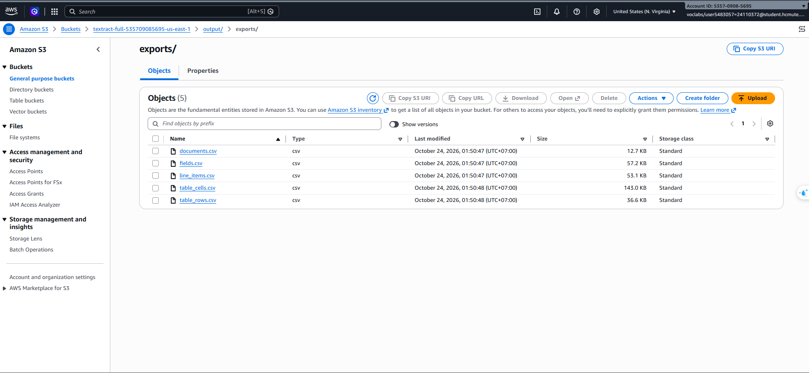
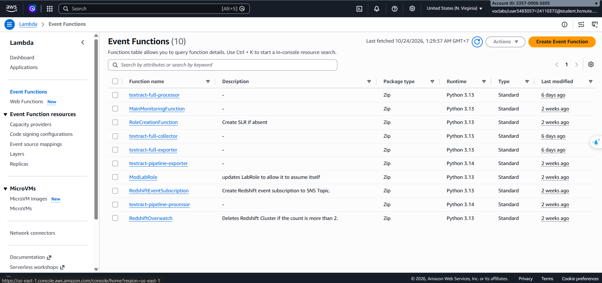
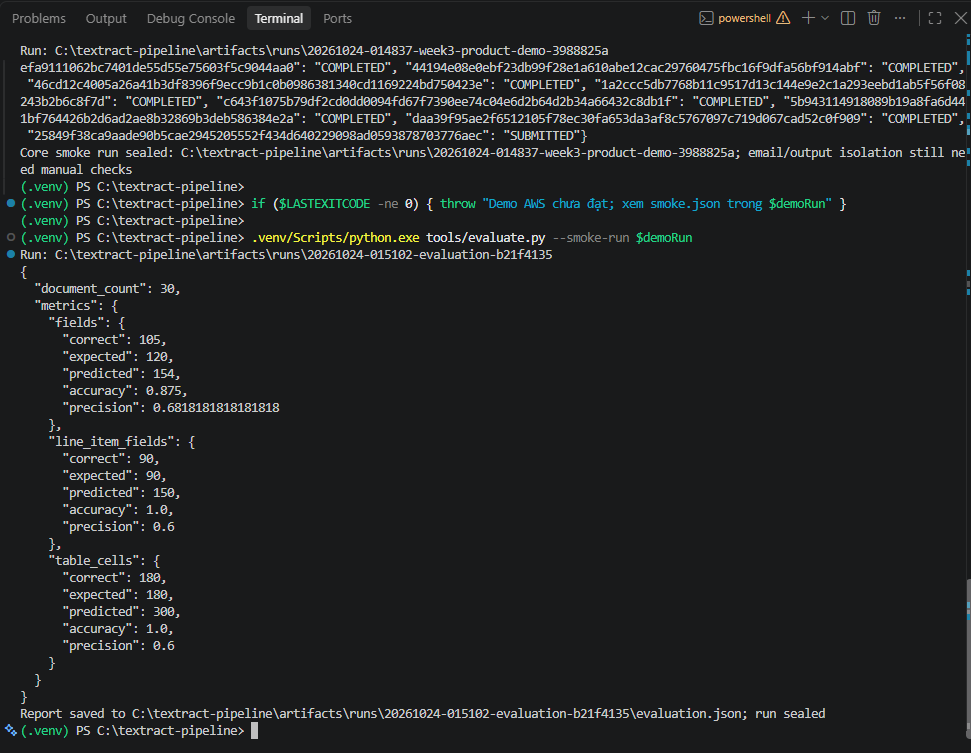
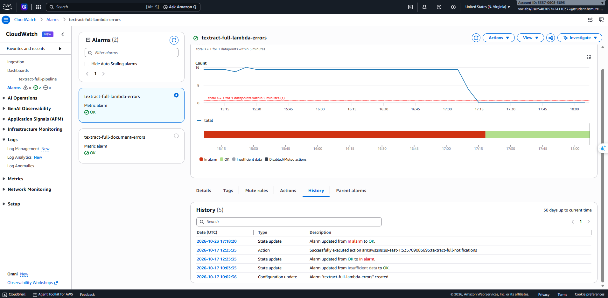

# Báo cáo tuần 3 — Tích hợp, bảo mật, giám sát và đánh giá

Ngày tổng hợp: 24/10/2026, múi giờ Việt Nam (UTC+07:00).

**Cập nhật demo trực tiếp:** sinh viên đã chạy lại sản phẩm trên AWS từ 01:48:38 đến 01:50:51 ngày 24/10/2026. Run `20261024-014837-week3-product-demo-3988825a` PASS, đủ **31/31 tài liệu COMPLETED**: 15 hóa đơn ảnh, 15 biểu mẫu ảnh và một PDF hai trang. Evaluation mới `20261024-015102-evaluation-b21f4135` PASS lúc 01:51:03, chấm 30 ảnh với kết quả fields 87,5%, line item fields 100%, table cells 100%; precision tương ứng 68,18%, 60%, 60%. Kết quả này thay thế tình trạng chưa có lượt demo mới ở bước preflight của trợ lý trước đó.

[Bộ minh chứng demo lưu cùng báo cáo](evidence/20261024-014837-product-demo/README.md) gồm tài liệu mẫu, ground truth, năm CSV, smoke/evaluation JSON, manifest nguồn và nội dung terminal. Bộ này có hướng dẫn chấm lại offline và manifest hash để giữ cùng hồ sơ Git; không phụ thuộc duy nhất vào liên kết tới `artifacts/` đang bị Git ignore.

## 1. Phạm vi và môi trường

Tuần 3 tiếp tục sử dụng CloudFormation stack đã triển khai ở tuần 2 trên AWS Learner Lab; không tạo một bộ pipeline mới cho tuần 3.

| Thành phần | Giá trị |
| --- | --- |
| Account | `535709085695` |
| Region | `us-east-1` |
| Stack chính | `textract-full` |
| Bucket nhận tài liệu và lưu kết quả | `textract-full-535709085695-us-east-1` |
| DynamoDB | `textract-full-results` |
| Lambda | `textract-full-processor`, `textract-full-collector`, `textract-full-exporter` |
| SNS | `textract-full-notifications` |
| Execution role | `LabRole` có sẵn của Learner Lab |

Tuần 1 dựng tài nguyên thủ công với tên `textract-pipeline-*`. Tuần 2 chuyển bản triển khai chính sang CloudFormation với tên `textract-full-*`. Bucket tuần 1 `textract-pipeline-535709085695` được tái sử dụng để lưu gói ZIP triển khai Lambda; vì vậy không coi mọi tài nguyên mang tên cũ là tài nguyên có thể xóa. Vai trò này được ghi trong [deployment evidence tuần 2](../week2/evidence/deployment.json).

Kiến trúc và template: [sơ đồ kiến trúc](../architecture.md), [CloudFormation](../../infra/template.yaml).

### Đối chiếu yêu cầu sản phẩm

| Yêu cầu | Bằng chứng thực tế đã có | Kết luận về chức năng |
| --- | --- | --- |
| S3 → Lambda | Smoke lưu object/version upload vào bucket chính và đọc được trạng thái của đúng document ID | Đã chạy trên AWS |
| AnalyzeExpense và AnalyzeDocument | Gói Lambda đã triển khai có hai nhánh API; 15 invoice và 15 form trong CSV của batch đều COMPLETED | Đã có kết quả cho cả hai loại tài liệu |
| DynamoDB | Smoke đọc META của đúng 30 document ID từ bảng `textract-full-results`; Exporter xuất các bản ghi nghiệp vụ | Đã có dữ liệu thật |
| Xuất CSV | Exporter tạo và script tải được năm CSV từ S3 | Đã chạy trên AWS |
| Đánh giá ít nhất 30 tài liệu | Evaluation có 30 tài liệu, ground truth, CSV đầu vào và provenance | Đã thực hiện; fields đạt 87,5%, không tuyên bố 100% toàn hệ thống |
| PDF bất đồng bộ bổ sung | PDF của demo mới có document ID `25849f38ca9aade90b5cae2945205552f434d640229098ad0593878703776aec`, pages=2, COMPLETED | Đã chạy lại thành công ngày 24/10 |

Các chức năng sản phẩm dự kiến đã có bằng chứng chạy thật và đã được sinh viên demo lại trên AWS ngày 24/10. Tích hợp, cấu hình bảo mật, CloudWatch/SNS và IaC cũng đã triển khai; buổi tuần 3 xác nhận cấu hình và bổ sung đánh giá 30 tài liệu. Trợ lý kiểm tra các run đã lưu sau khi sinh viên chạy trong terminal có credentials; không tự nhận đã thực thi AWS từ phiên công cụ thiếu credentials. Kết luận kỹ thuật này không thay thế kết luận chấm điểm của giảng viên.

## 2. Lượt chạy AWS và nguồn số liệu

Lượt chạy 30 tài liệu bắt đầu lúc `2026-10-24T00:28:13+07:00`. Sinh viên khởi động Learner Lab và thực thi script với `--learner-lab-active`. Smoke evidence lưu account, Region, ARN tài nguyên, các object/version đã upload và trạng thái DynamoDB.

| Lượt chạy | Đường dẫn |
| --- | --- |
| Deployment tuần 2 | `artifacts/runs/20261017-165747-aws-deployment-f0f65a25` |
| AWS smoke 30 tài liệu | `artifacts/runs/20261024-002810-aws-smoke-accuracy-fc93f0c6` |
| Evaluation ban đầu | `artifacts/runs/20261024-003047-evaluation-727f9d2f` |
| Evaluation sau sửa cách đối chiếu bảng | `artifacts/runs/20261024-003342-evaluation-table-remap-a35eb328` |
| Chấm lại offline để xác nhận tái lập | `artifacts/runs/20261024-014502-evaluation-259f0e0c` |
| Demo trực tiếp mới: 30 ảnh + PDF | `artifacts/runs/20261024-014837-week3-product-demo-3988825a` |
| Evaluation của demo trực tiếp mới | `artifacts/runs/20261024-015102-evaluation-b21f4135` |

Nguồn chính: [smoke.json](../../artifacts/runs/20261024-002810-aws-smoke-accuracy-fc93f0c6/smoke.json), [smoke manifest](../../artifacts/runs/20261024-002810-aws-smoke-accuracy-fc93f0c6/manifest.json), [evaluation.json hiện tại](../../artifacts/runs/20261024-003342-evaluation-table-remap-a35eb328/evaluation.json), [evaluation manifest](../../artifacts/runs/20261024-003342-evaluation-table-remap-a35eb328/manifest.json).

Các đường dẫn run trên trỏ tới dữ liệu có sẵn tại workspace. Cần giữ các run gốc để mở đầy đủ lịch sử package và source snapshot. Bộ demo mới đã có bản lưu dataset/CSV/kết quả trong `evidence/20261024-014837-product-demo` để chấm lại offline khi bàn giao báo cáo; không cần đưa toàn bộ gói ZIP Lambda vào thư mục báo cáo.

Ngày 24/10, đã gọi `Run.read()` và `validate_files()` cho deployment tuần 2, smoke tuần 2, smoke 30 tài liệu và evaluation sau sửa cách ghép bảng: tất cả hash/size khớp manifest PASS. Đối chiếu đúng document ID trong CSV cho kết quả 15 invoice + 15 form, 30 COMPLETED và 30 notification_status=DELIVERED. Trạng thái DELIVERED trong ứng dụng xác nhận API publish, còn việc người nhận nhận email được chứng minh thêm bằng ảnh Gmail. Mã API được đọc trực tiếp từ ZIP Lambda của deployment đã xác thực hash, không chỉ từ source đang làm việc.

Lượt [evaluation chấm lại offline](../../artifacts/runs/20261024-014502-evaluation-259f0e0c/evaluation.json) hoàn tất với cùng số liệu của evaluation sau sửa cách ghép bảng.

Nguồn demo mới: [smoke.json](../../artifacts/runs/20261024-014837-week3-product-demo-3988825a/smoke.json), [smoke manifest](../../artifacts/runs/20261024-014837-week3-product-demo-3988825a/manifest.json), [evaluation.json](../../artifacts/runs/20261024-015102-evaluation-b21f4135/evaluation.json), [evaluation manifest](../../artifacts/runs/20261024-015102-evaluation-b21f4135/manifest.json). Đã kiểm tra hash/size của cả hai run mới, đều khớp manifest PASS. Trạng thái `SUBMITTED` xuất hiện trong các lần thăm dò PDF là trạng thái trung gian; kết quả cuối trong smoke.json là COMPLETED cho cả 31 document ID.

CSV của demo mới nằm trong [exports](../../artifacts/runs/20261024-014837-week3-product-demo-3988825a/exports). Export toàn bảng có 68 dòng documents, 367 fields, 64 line_items, 760 table_cells và 266 table_rows vì giữ cả revision/lượt cũ; evaluator vẫn chấm đúng 30 source key của ground truth, không tính 68 dòng là 68 tài liệu mẫu độc lập. PDF của demo mới có pages=2, COMPLETED và notification_status=DELIVERED trong documents.csv. Các CSV được lưu kèm minh chứng Git: [documents.csv](evidence/20261024-014837-product-demo/exports/documents.csv), [fields.csv](evidence/20261024-014837-product-demo/exports/fields.csv), [line_items.csv](evidence/20261024-014837-product-demo/exports/line_items.csv), [table_cells.csv](evidence/20261024-014837-product-demo/exports/table_cells.csv) và [table_rows.csv](evidence/20261024-014837-product-demo/exports/table_rows.csv).



## 3. Tích hợp pipeline và xuất CSV

Bộ đánh giá gồm 30 ảnh tài liệu giả lập tiếng Anh: 15 hóa đơn và 15 biểu mẫu. Cả 30 tài liệu đều có trạng thái `COMPLETED`. Batch ban đầu lúc 00:28 sử dụng `--all --no-pdf`. Demo sau đó lúc 01:48 chạy `--all` với PDF bật, bổ sung bằng chứng PDF tuần 3; mẫu số accuracy vẫn là 30 ảnh có ground truth.

Smoke ghi nhận phản hồi `DUPLICATE_OR_IN_PROGRESS` khi phát lại sự kiện cho tài liệu đã có. Exporter tạo và script tải về năm CSV thật:

| CSV | Số dòng trong bản export toàn bảng |
| --- | ---: |
| `documents.csv` | 37 |
| `fields.csv` | 200 |
| `line_items.csv` | 34 |
| `table_cells.csv` | 420 |
| `table_rows.csv` | 147 |

Các số dòng này gồm cả dữ liệu có từ trước. Evaluator giới hạn việc chấm theo 30 source key trong ground truth và chọn revision theo quy tắc của evaluator; không lấy toàn bộ 37 dòng tài liệu làm mẫu số đánh giá.

Ảnh Console bổ sung trong buổi làm việc cho thấy `output/` có 38 mục. Số mục ở màn hình thư mục có thể gồm folder/prefix, không được diễn giải thành 38 tài liệu trong bộ đánh giá. Sự tồn tại của đầu ra và CSV đã được ghi nhận; không yêu cầu upload thêm file chỉ để chứng minh đầu ra tồn tại.

## 4. Kết quả đánh giá độ chính xác

| Nhóm dữ liệu | Đúng / kỳ vọng | Số dự đoán | Accuracy theo ground truth | Precision |
| --- | ---: | ---: | ---: | ---: |
| Fields | 105 / 120 | 154 | 87,50% | 68,18% |
| Line item fields | 90 / 90 | 150 | 100,00% | 60,00% |
| Table cells | 180 / 180 | 300 | 100,00% | 60,00% |
| Line item rows | 30 / 30 | 30 | 100,00% | 100,00% |

`Accuracy` trong công cụ là số mục kỳ vọng được khớp chia cho số mục kỳ vọng; precision là số mục khớp chia cho số dự đoán. Do có các trường/ô được trích xuất ngoài phạm vi ground truth, accuracy 100% của một nhóm không đồng nghĩa mọi dự đoán trong nhóm đều đúng. `COMPLETED` cũng không đồng nghĩa accuracy 100%.

Mười lăm mismatch của nhóm fields đều thuộc `VENDOR_NAME`. Đối chiếu trước đó cho thấy có trường hợp nội dung tên nhà cung cấp được đọc ra nhưng phân loại thành `OTHER`; cần phân biệt lỗi phân loại trường với lỗi đọc ký tự. Kết quả 87,5% được giữ nguyên, không đổi tiêu chí chỉ để đạt mục tiêu tham khảo 90%.

Evaluation ban đầu báo table cells bằng 0% vì dùng số thứ tự bảng làm định danh: ground truth và Textract có thể đánh số khác nhau khi Textract còn xuất bảng key/value. Evaluator sau đó ghép bảng cùng tài liệu/trang theo độ trùng vị trí hàng/cột và chấm giá trị từng ô. Kết quả chấm lại từ CSV đã lưu là 180/180. Giữ nguyên cả hai run để truy vết; lượt chấm lại không gọi Textract.

Ảnh CLI dưới đây thuộc evaluation ban đầu và còn hiển thị table cells 0%. Số liệu hiện tại lấy từ evaluation sau sửa cách ghép bảng đã liên kết ở trên.


Bộ mẫu là tài liệu tổng hợp theo template, không có dữ liệu cá nhân thật. Kết quả này chưa đại diện cho ảnh chụp thực tế, tiếng Việt hoặc nhiều bố cục khác nhau.

## 5. Kiểm tra bảo mật trên Console

Các ảnh do sinh viên cung cấp trong buổi làm việc đã được đối chiếu với cấu hình dự kiến:

| Hạng mục | Kết quả quan sát |
| --- | --- |
| Block public access | On, đủ bốn tùy chọn |
| Bucket policy | Deny `s3:*` với `aws:SecureTransport = false`, áp dụng cho bucket và object |
| Versioning | Enabled |
| Default encryption | SSE-S3 |
| Tags của bucket chính | `Project=TextractDocumentDigitization`, `Owner=24110372-24110381` |
| Execution role của ba Lambda chính | Cả Processor, Collector và Exporter đều hiện `LabRole` |
| Quyền S3 invoke Processor | Giới hạn theo đúng SourceAccount và ARN bucket chính |






Console có thông báo explicit deny `iam:GetPolicy` cho phiên đăng nhập `voclabs`. Ghi nhận đây là hạn chế đọc IAM policy của phiên lab; không suy diễn thành kết luận mọi API nghiệp vụ bị từ chối. Kết quả chạy thật và tên execution role là các bằng chứng độc lập. Phần này xác nhận những cấu hình đã xem, chưa phải một cuộc kiểm toán toàn bộ quyền IAM.

## 6. Giám sát và SNS

CloudWatch có dashboard `textract-full-pipeline`, các log group của ba Lambda có retention 14 ngày và hai alarm `textract-full-lambda-errors`, `textract-full-document-errors`. Ở thời điểm kiểm tra Console, cả hai alarm đều OK.




Lịch sử alarm do sinh viên cung cấp cho thấy alarm Lambda từng chuyển sang ALARM sau datapoint total=1 tại `2026-10-17T12:20:00Z`, rồi về OK lúc `2026-10-23T17:18:20Z` sau datapoint total=0 tại `2026-10-23T17:13:00Z`. Đây lần lượt là 19:20 ngày 17/10 và 00:18:20 ngày 24/10 theo giờ Việt Nam. Lịch sử này không xác định nguyên nhân gốc và không chứng minh lỗi xảy ra liên tục giữa hai mốc.

Tìm chuỗi `ERROR` trong Processor/Collector và `document_error` trong Collector không trả về sự kiện ở phạm vi tìm kiếm đã xem. Không dùng việc không tìm thấy chuỗi để phủ nhận metric lỗi lịch sử.

Topic chính `textract-full-notifications` có email subscription Confirmed. Hộp thư nhận nhiều email `Textract COMPLETED` lúc 00:28, khớp các document ID/source key trong lượt chạy. Hộp thư còn có email alarm cũ ngày 17/10. Không lấy tổng số thư trong Gmail làm số email riêng của run mới.


## 7. Phạm vi minh chứng cho trigger output

Smoke đã đọc cấu hình notification thật của bucket và xác nhận prefix `input/` cho Processor. Smoke cũng invoke Exporter và tải được năm CSV ở `output/exports/`. Đây là bằng chứng cấu hình và vận hành xuất dữ liệu đã có.

Một phép thử upload riêng vào `output/` với mốc trước/sau, cửa sổ quan sát và đối chiếu invocation/log chưa được ghi nhận hoàn chỉnh trên stack chính. Giữ trạng thái phép thử độc lập đó là **NOT_RUN**, không sửa các run đã đóng để thành PASS. Ảnh thư mục output hoặc `No data available` riêng lẻ không thay thế phép đo đó. Việc thu thập báo cáo tuần 3 tiếp tục dựa trên những bằng chứng đã có; không yêu cầu sinh viên upload thử thêm ở buổi tổng hợp này.

## 8. Tái lập việc chấm từ kết quả đã lưu

Chạy tại root dự án, tạo evaluation run mới thay vì sửa run cũ:

```powershell
$evaluationRun = "artifacts/runs/$(Get-Date -Format yyyyMMdd-HHmmss)-evaluation-$([guid]::NewGuid().ToString('N').Substring(0,8))"
.venv/Scripts/python.exe tools/evaluate.py --smoke-run artifacts/runs/20261024-002810-aws-smoke-accuracy-fc93f0c6 --run-dir $evaluationRun
```

Lệnh này chấm CSV đã lưu, không chạy lại AWS. Muốn xử lý lại tài liệu trên AWS phải có phiên Learner Lab đang hoạt động, temporary credentials hợp lệ và truyền `--learner-lab-active`; xem [hướng dẫn kiểm thử](../guides/testing.md).

### Demo lại toàn bộ sản phẩm trên AWS

Preflight STS trong phiên công cụ của trợ lý trả `NoCredentials`. Sinh viên sau đó đã chạy block dưới đây thành công trong terminal có credentials của Learner Lab đang hoạt động; kết quả là demo run và evaluation run lúc 01:48/01:51 liên kết ở trên. Block được giữ làm hướng dẫn tái lập khi cần demo lại; không cần chạy lặp để hoàn thiện bản báo cáo hiện tại:

```powershell
$demoRun = "artifacts/runs/$(Get-Date -Format yyyyMMdd-HHmmss)-week3-product-demo-$([guid]::NewGuid().ToString('N').Substring(0,8))"
.venv/Scripts/python.exe tools/smoke_aws.py --stack textract-full --region us-east-1 --all --learner-lab-active --deployment-run artifacts/runs/20261017-165747-aws-deployment-f0f65a25 --run-dir $demoRun
if ($LASTEXITCODE -ne 0) { throw "Demo AWS chua dat; xem smoke.json trong $demoRun" }
.venv/Scripts/python.exe tools/evaluate.py --smoke-run $demoRun
```

Block này upload 30 ảnh và một PDF hai trang, đợi trạng thái DynamoDB, kiểm tra duplicate, xuất/tải CSV và chấm lại 30 ảnh theo ground truth. PDF nằm ngoài mẫu số accuracy. Script đối chiếu account/stack/hash code trước upload, không tạo lại hạ tầng; mỗi lần chạy tạo revision dữ liệu mới và sử dụng dịch vụ AWS thật. Nếu pipeline hoặc export thất bại thì không chạy scoring. Scoring thành công không đồng nghĩa vượt một ngưỡng accuracy bắt buộc.

## 9. AI hỗ trợ và phần hồ sơ còn cần hoàn thiện

AI hỗ trợ đọc mã nguồn/bằng chứng, cập nhật smoke tooling với cổng xác nhận phiên lab, cập nhật evaluator để lưu provenance và đối chiếu bảng, phân tích kết quả và soạn bản tổng hợp này. Sinh viên thực thi lệnh AWS trong phiên lab của mình, thao tác Console và cung cấp ảnh. Sinh viên cần giải thích được trigger prefix, vai trò ba Lambda, AnalyzeExpense/AnalyzeDocument, LabRole, điều kiện bucket policy, cách tính accuracy/precision và giới hạn của bằng chứng.

Worklog tại [WORKLOG.md](../../WORKLOG.md) cần ghi công việc, phân công và số giờ thực tế của từng sinh viên; bản tổng hợp này không tự điền số giờ. Chi phí cuối kỳ, kiểm thử tổng thể, video demo và cleanup thuộc kế hoạch tuần 4, chưa được tuyên bố hoàn thành ở đây. Template giữ lại S3/DynamoDB bằng `Retain`, nên kế hoạch cleanup cần bao gồm các tài nguyên đó và inventory tài nguyên tuần 1 còn dùng.

Các ảnh Console bổ sung được chọn lọc và lưu trong [assets](assets/), gồm danh sách Lambda, kết quả evaluation, lịch sử alarm và năm CSV trên S3. Các ảnh chỉ làm rõ trạng thái đã ghi nhận; chúng không thay thế dữ liệu JSON/CSV và manifest của từng lượt chạy trong bộ minh chứng.
