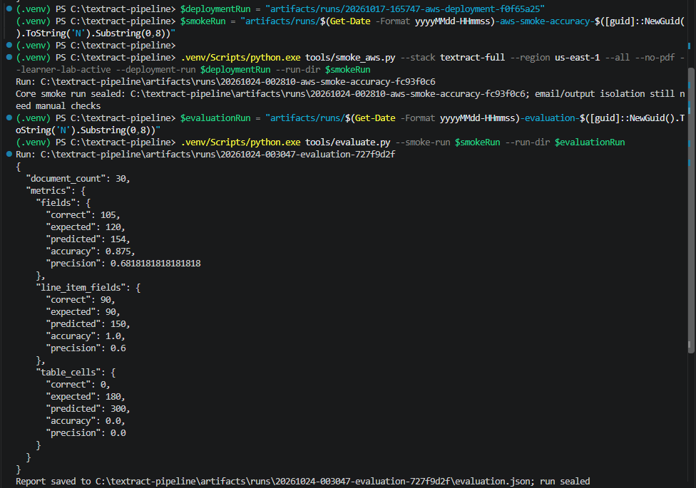
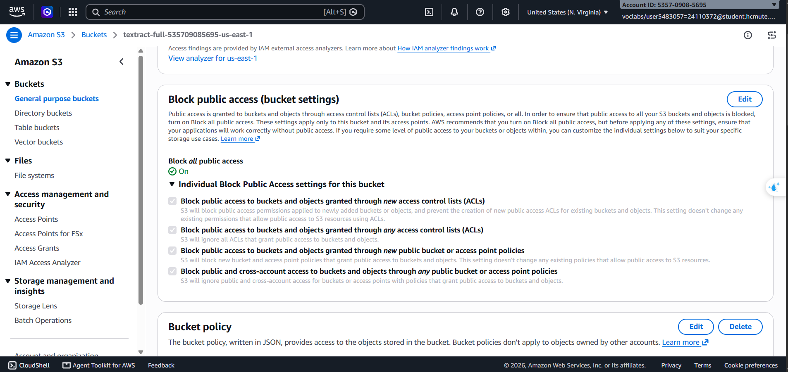
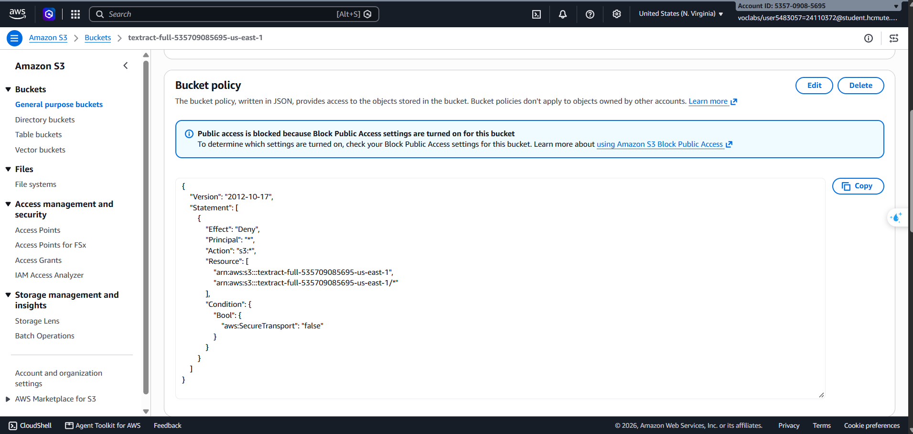
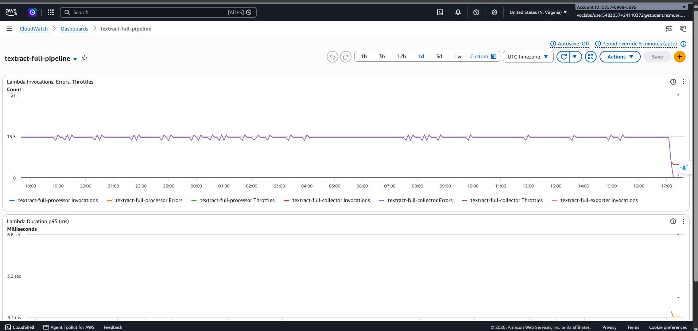
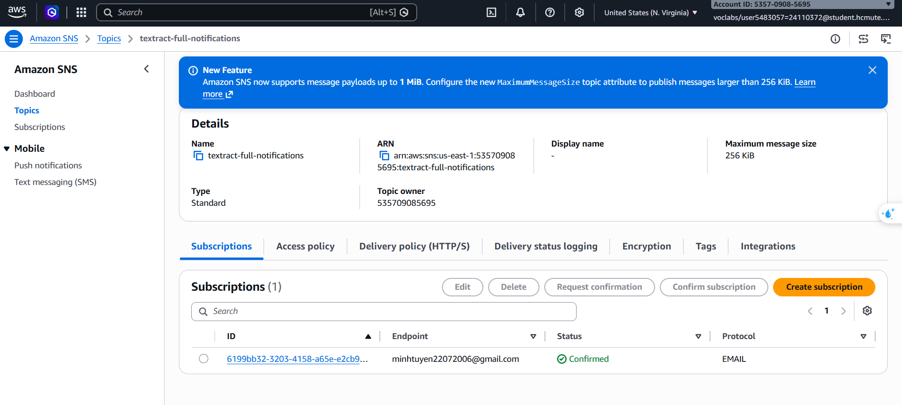
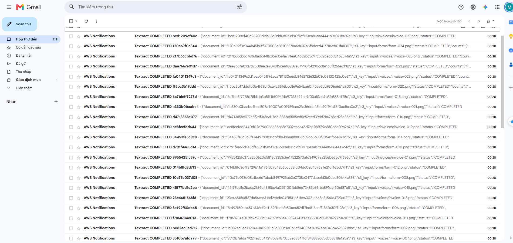

# Báo cáo tuần 3 — Tích hợp, bảo mật và giám sát

## 1. Mục tiêu

Trong tuần 3, nhóm em tiếp tục hoàn thiện và chạy thử hệ thống số hóa hóa đơn, biểu mẫu trên AWS. Nhóm kiểm tra luồng S3 → Lambda → Textract → DynamoDB, chức năng xuất CSV, đánh giá kết quả trên 30 tài liệu, đồng thời rà soát cấu hình bảo mật và theo dõi hệ thống bằng CloudWatch, SNS.

Nhóm sử dụng lại stack CloudFormation `textract-full` đã triển khai ở tuần 2, không tạo thêm một pipeline riêng.

| Thành phần | Giá trị |
| --- | --- |
| Môi trường | AWS Academy Learner Lab |
| Account | `535709085695` |
| Region | `us-east-1` |
| Stack | `textract-full` |
| S3 bucket | `textract-full-535709085695-us-east-1` |
| DynamoDB | `textract-full-results` |
| Lambda | `textract-full-processor`, `textract-full-collector`, `textract-full-exporter` |
| SNS topic | `textract-full-notifications` |
| Execution role | `LabRole` do Learner Lab cấp |

Tuần 1 nhóm em tạo tài nguyên với tên `textract-pipeline-*`; tuần 2 chuyển pipeline chính sang CloudFormation với tên `textract-full-*`. Bucket tuần 1 `textract-pipeline-535709085695` vẫn được dùng để lưu gói ZIP triển khai, vì vậy nhóm không xóa bucket này. Chi tiết nằm trong [deployment evidence tuần 2](../week2/evidence/deployment.json). Sơ đồ và cấu hình hạ tầng: [sơ đồ kiến trúc](../architecture.md), [CloudFormation template](../../infra/template.yaml).

## 2. Các công việc đã thực hiện

### 2.1. Chạy pipeline với tài liệu mẫu

Nhóm tạo bộ dữ liệu tổng hợp gồm 30 ảnh PNG: 15 hóa đơn và 15 biểu mẫu, kèm ground truth để so sánh kết quả. Khi tải tài liệu lên prefix `input/`, S3 kích hoạt Processor. Processor gọi `AnalyzeExpense` cho hóa đơn và `AnalyzeDocument` với `FORMS`/`TABLES` cho biểu mẫu; kết quả được ghi vào DynamoDB. Tài liệu PDF nhiều trang được xử lý bất đồng bộ: Collector lấy kết quả Textract sau khi tác vụ hoàn tất rồi cập nhật DynamoDB.

Ngày 24/10/2026 nhóm chạy batch 30 ảnh. Cả 30 tài liệu có trạng thái `COMPLETED`. Nhóm phát lại sự kiện của tài liệu đã xử lý để kiểm tra chống trùng; Processor trả về `DUPLICATE_OR_IN_PROGRESS`.

Sau đó nhóm chạy demo đầu-cuối lần nữa với 30 ảnh và một PDF hai trang. Run `20261024-014837-week3-product-demo-3988825a` hoàn tất **31/31 tài liệu**. Evaluation `20261024-015102-evaluation-b21f4135` chấm 30 ảnh có ground truth; PDF được dùng để minh họa luồng bất đồng bộ, không tính vào mẫu số accuracy.

Các bước demo đã thực hiện:

1. Khởi động Learner Lab và chạy smoke test bằng credentials của phiên lab.
2. Tải 30 ảnh và PDF hai trang lên S3, sau đó chờ Lambda/Textract xử lý.
3. Đối chiếu trạng thái tài liệu trong DynamoDB; kiểm tra sự kiện trùng.
4. Chạy Exporter để tạo năm CSV trong `output/exports/` trên S3.
5. Chấm kết quả CSV với ground truth của 30 ảnh.

Bộ minh chứng có thể xem trong [thư mục demo trên GitHub](evidence/20261024-014837-product-demo/README.md), gồm dữ liệu mẫu, ground truth, smoke/evaluation JSON, manifest, nội dung terminal và năm CSV. Run ID nguồn: `20261024-014837-week3-product-demo-3988825a` và `20261024-015102-evaluation-b21f4135`.

### 2.2. Xuất CSV

Exporter tạo các tệp `documents.csv`, `fields.csv`, `line_items.csv`, `table_cells.csv` và `table_rows.csv`. Các tệp được ghi lên S3 tại `output/exports/`; smoke test cũng tải bản sao về thư mục `exports/` của run trên máy. **Upload tài liệu lên S3 không tự tải CSV về máy tính.**

CSV là bản xuất tổng hợp nên có dữ liệu từ những lần chạy trước. Bản xuất của demo mới có 68 dòng documents, 367 fields, 64 line items, 760 table cells và 266 table rows. Các con số này không phải số lượng tài liệu mẫu dùng để chấm; evaluator chỉ chấm 30 source key có ground truth. Có thể mở từng tệp trong [bộ minh chứng](evidence/20261024-014837-product-demo/exports/).

### 2.3. Đánh giá kết quả trích xuất

Kết quả evaluation của 30 ảnh:

| Nhóm dữ liệu | Khớp / kỳ vọng | Số dự đoán | Accuracy/recall | Precision |
| --- | ---: | ---: | ---: | ---: |
| Fields | 105 / 120 | 154 | 87,50% | 68,18% |
| Line item fields | 90 / 90 | 150 | 100,00% | 60,00% |
| Table cells | 180 / 180 | 300 | 100,00% | 60,00% |
| Line item rows | 30 / 30 | 30 | 100,00% | 100,00% |

Trong evaluator, accuracy/recall là số mục ground truth được khớp chia cho tổng số mục ground truth; precision là số mục khớp chia cho tổng số dự đoán. Vì vậy, accuracy 100% không có nghĩa mọi dự đoán đều đúng: một số trường/ô dự đoán nằm ngoài ground truth làm precision thấp hơn.

15 mismatch của nhóm fields đều thuộc `VENDOR_NAME`. Có trường hợp Textract đọc được nội dung tên nhà cung cấp nhưng gán loại trường là `OTHER`. Lần chấm table cells đầu tiên cho kết quả 0% do ground truth và Textract đánh số bảng khác nhau. Nhóm điều chỉnh cách ghép bảng theo tài liệu, trang và vị trí hàng/cột, rồi chấm lại CSV đã lưu được 180/180. Kết quả table cells cần được hiểu trong giới hạn cách ghép có tham chiếu ground truth; lần chấm lại không gọi Textract.

Bộ tài liệu là dữ liệu tổng hợp bằng tiếng Anh theo template, không chứa dữ liệu cá nhân thật. Kết quả hiện tại chưa đại diện cho tài liệu chụp thực tế, tài liệu tiếng Việt hoặc nhiều kiểu bố cục khác nhau.

### 2.4. Kiểm tra bảo mật

Nhóm kiểm tra cấu hình bucket và Lambda trên AWS Console:

| Hạng mục | Kết quả |
| --- | --- |
| S3 Block Public Access | Bật đủ bốn tùy chọn |
| Bucket policy | Từ chối `s3:*` khi `aws:SecureTransport=false`, yêu cầu HTTPS |
| Versioning | Enabled |
| Mã hóa mặc định | SSE-S3 |
| Tags | `Project=TextractDocumentDigitization`, `Owner=24110372-24110381` |
| Execution role của Processor, Collector, Exporter | `LabRole` |
| Quyền S3 gọi Processor | Giới hạn theo SourceAccount và ARN của bucket chính |

Khi xem cấu hình quyền trên Console, phiên `voclabs` báo explicit deny với `iam:GetPolicy`. Đây là giới hạn quyền đọc IAM policy của Learner Lab; nhóm không suy rộng thành lỗi của các API xử lý tài liệu. Phần kiểm tra này xác nhận các cấu hình đã xem, chưa phải kiểm toán toàn bộ quyền IAM.

### 2.5. CloudWatch và SNS

Nhóm theo dõi dashboard `textract-full-pipeline`, log group của Lambda (retention 14 ngày) và hai alarm `textract-full-lambda-errors`, `textract-full-document-errors`. Ở lần mở Console, hai alarm hiển thị `OK`.

History cho thấy alarm Lambda từng chuyển sang `ALARM` sau datapoint `total=1` lúc `2026-10-17T12:20:00Z`, rồi chuyển về `OK` lúc `2026-10-23T17:18:20Z`, sau datapoint `total=0` lúc `2026-10-23T17:13:00Z`. Đây là các mốc 19:20 ngày 17/10 và 00:18 ngày 24/10 theo giờ Việt Nam. Ảnh Console ngày 25/10 cũng ghi nhận alarm document errors ở trạng thái `ALARM` sau một datapoint lỗi. Nhóm chưa xác định được nguyên nhân gốc của các datapoint này.

Nhóm tìm `ERROR` trong log Processor/Collector và `document_error` trong Collector nhưng không thấy sự kiện khớp trong phạm vi đã xem. Việc tìm không thấy log đó không phủ nhận metric lỗi trong lịch sử alarm.

SNS topic `textract-full-notifications` có email subscription ở trạng thái Confirmed. Hộp thư nhận được email `Textract COMPLETED` của batch và email alarm. Nhóm đối chiếu nội dung email với document ID/source key; không lấy tổng số thư trong hộp thư làm số email riêng của run mới.

### 2.6. IaC và chi phí

Tuần 3 nhóm tiếp tục sử dụng stack `textract-full` được triển khai bằng CloudFormation từ tuần 2. Template triển khai các tài nguyên chính; các Lambda dùng `LabRole` có sẵn của Learner Lab. Trong tuần này nhóm rà soát cấu hình và chạy demo trên stack hiện có, không dựng lại hạ tầng.

Khi kiểm tra Cost Explorer ngày 25/10, tổng chi phí hiển thị khoảng **0,21 USD** cho giai đoạn 18–25/10; khoản Textract được ghi nhận vào ngày 18/10. Đây là số liệu tại thời điểm truy vấn và có thể thay đổi khi AWS cập nhật billing.

## 3. Kết quả và phần cần tiếp tục

Qua các lượt chạy, nhóm đã có bằng chứng cho luồng xử lý hóa đơn, biểu mẫu và PDF; lưu kết quả vào DynamoDB; chống xử lý trùng; xuất năm CSV; nhận thông báo SNS; và đánh giá 30 ảnh có ground truth. Kết quả fields đạt 87,50% accuracy/recall, nên hệ thống vẫn cần cải thiện phân loại `VENDOR_NAME` và được thử thêm trên tài liệu thực tế.

Một phép thử riêng upload một tệp vào `output/`, ghi invocation trước/sau và đối chiếu log để xác nhận prefix này không kích hoạt Processor chưa có kết quả hoàn chỉnh trên stack chính. Vì vậy nhóm không tính phép thử đó là PASS. Việc phân tích nguyên nhân các datapoint lỗi, theo dõi chi phí cuối kỳ, quay video demo và cleanup được tiếp tục trong tuần 4.

## 4. Tài liệu và mã nguồn

- [Bộ minh chứng demo, ground truth và CSV](evidence/20261024-014837-product-demo/README.md)
- [Ảnh AWS Console](assets/)
- [CloudFormation template](../../infra/template.yaml)
- [Mã Lambda](../../src/textract_pipeline/)
- [Script smoke test AWS](../../tools/smoke_aws.py), [script đánh giá](../../tools/evaluate.py), [script tạo dữ liệu mẫu](../../tools/generate_samples.py)
- [Kế hoạch dự án](../plan.md), [hồ sơ kiểm chứng](../verification.md), [worklog](../../WORKLOG.md)

## 5. Khai báo sử dụng AI

Trong quá trình làm báo cáo và rà soát mã nguồn, nhóm có sử dụng ChatGPT/Codex để hỗ trợ xem kết quả smoke/evaluation, diễn giải các chỉ số, chỉnh công cụ đánh giá và soạn thảo tài liệu. Nhóm em tự khởi động Learner Lab, chạy demo bằng phiên AWS của mình, thao tác trên Console và đối chiếu kết quả với dữ liệu thực tế. Nhóm chịu trách nhiệm kiểm tra và giải thích nội dung đã nộp.
